<div align="center">

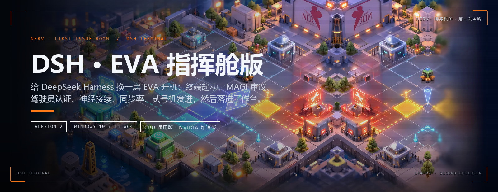

# DSH · EVA 指挥舱版

**给 DeepSeek Harness 换一层 EVA 开机：六场启动序列，然后落进工作台。**

<p>


</p>

[项目简介](#项目简介) · [功能亮点](#功能亮点) · [展示区](#展示区) · [目录与文件说明](#目录与文件说明) · [安装与使用](#安装与使用) · [注意事项](#注意事项) · [常见问题](#常见问题)

</div>

---

## 项目简介

这是一套 **Windows 安装包构建套件**：把 DeepSeek Harness（DSH）桌面端打包装进一层 EVA 风格的「指挥舱」外壳里，打开应用先播一段六场开机动画，再进入工作台。

开机序列不是贴片视频，而是按本机真实状态渲染的流程：

| 场次 | 屏幕上写的 | 实际在做什么 |
|---|---|---|
| 01 | `NERV` | 标志浮出、格言逐字打出、第壹话标题卡落下。纯本地渲染 |
| 02 | `MAGI SYSTEM` | 三个「贤人」并行体检：主机连接、模型目录、访问权限 |
| 03 | `PILOT AUTH` | 插入栓 02 锁定，身份卡核对驾驶员名称、工作区、登录状态 |
| 04 | `NEURAL LINK` | A10 线路逐条接续，读的是本机 DSH 的技能清单与插件清单 |
| 05 | `SYNC RATIO` | 同步率随接续结果爬升，接不上就停住并说明原因 |
| 06 | `LAUNCH` | 最终安全装置解除，贰号机发进，进入工作台（`ESC` 可跳过） |

一句话概括：**外壳是《新世纪福音战士》的，内核还是你自己的 DSH。**

<sub>English: a Windows build kit that wraps DeepSeek Harness in an EVA-style cockpit with a six-scene boot sequence driven by real local state.</sub>

> ⚠️ **先说清楚三件事**
> 1. 这是**非官方**改装套件，与 DeepSeek、Khara / GAINAX 均无关联。
> 2. 展示区分两种：**实机演示**是对着显示器拍的屏摄，内容真实但有反光与摩尔纹；**其余画面**由仓库内自带的原始素材合成（背景板 + 机体立绘 + 同一套 HUD 排版，桌宠则是原装立绘帧 + 复刻的玻璃对话窗），**不是截图**；文案与场景流程取自源码。
> 3. **开源、可下载、可再分发**：构建脚本与打包内容以 **MIT** 发布，见 [LICENSE](LICENSE)。界面里的 EVA 角色形象版权归 Khara / GAINAX，属非商业同人使用，**不在 MIT 授权范围内**——这三类第三方内容的条款见 [THIRD-PARTY-NOTICES.md](THIRD-PARTY-NOTICES.md)。

---

## 功能亮点

### 开机这一层

| 亮点 | 说明 |
|---|---|
| ✅ 六场开机序列 | 每场都有独立画面与音效（`boot-sfx-*.ogg`、`boot-voice-*.ogg`），可用 `ESC` 整段跳过 |
| ✅ 状态是真的 | MAGI 三项检查、A10 接续清单、同步率全部读本机状态，超时会如实报错而不是假装通过 |
| ✅ 身份卡可改名 | 「指挥舱选项 → 驾驶员名称」里改，名字存本机，留空则用主机用户名 |
| ✅ 播放时机可选 | 每次打开 / 每天首次 / 关闭，也可以手动「重新播放开机动画」 |
| ✅ 低动效 | 机体直接移动、镜头静止，照顾晕动与低配机器 |

### 指挥舱这一层

| 界面 | 内容 |
|---|---|
| `01` 指挥舱 | 等距视角基地地图，Lead 开初号机、分析 Agent 开零号机·改、执行 Agent 开贰号机，在六栋建筑之间跑任务 |
| `02` 审议厅 | 智慧决策委员会：委员陈述、交叉质询、反方审计，讲台全息投影显示裁决 |
| `03` 聚焦 | 机体展台（可拖动 / `FRONT · 3/4 · SIDE · BACK` 旋转）、驾驶员卡、该 Agent 的任务与用量 |
| `04` 任务结算 | 三台机体同框，汇总子任务、参与 Agent、工时、Token、缓存命中与协同消息数 |
| `05` 编组 | 每台机体对应的 Agent、职责与入列规则，以及支援单元 |

键盘 `1`–`5` 切界面，`Esc` 回指挥舱。

### 第 2 版新增

- **智慧决策委员会**：请几位思想框架委员审议一个决策，过程在「02 审议厅」里看得见。
- **自动化任务页**：每次定时运行产出的文件，都能在运行记录里查看和打开。
- **开机身份卡**：驾驶员名称可以自己改。
- **明日香伴侣（实验）**：打字或语音聊天、闲聊、记会议纪要，会开口朗读，记忆按意思回忆，也能「放到桌面上」浮在其他程序上方。
- **修复**：多次启动后登录失败、应用打不开的问题。

---

## 展示区

### 实机演示（屏摄）

<table>
<tr>
<td width="50%">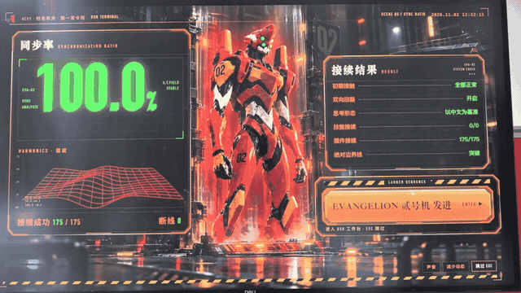<br><sub><b>开机段 · 同步率 → 安全装置解除 → 发进</b>　真实运行画面，不是渲染。</sub></td>
<td width="50%">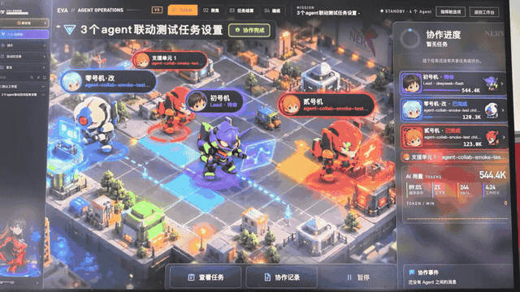<br><sub><b>工作台段 · 指挥舱地图 → 聚焦 → 协同任务完成</b>　机体在建筑间跑动是真实事件驱动的。</sub></td>
</tr>
</table>

<p align="center">
<a href="demo/DSH-EVA%20kit-Demo.mp4"><b>▶ 完整录屏 38 秒（1920×1080 · 含声音 · 45 MB）</b></a><br>
<sub>四段全流程：窗口内开机 → 全屏走完六场 → 终端 → 指挥舱地图 → 聚焦 → 结算</sub>
</p>

> 📱 **关于这段录屏，四件事先说清楚**
> - 画面是**对着显示器拍的**：有边框、反光与摩尔纹，动图已裁边，原片仍保留这些痕迹。
> - **音轨是后期配乐**，不是应用自己的开机音效（文件元数据里有即梦 / Dreamina 的导出记录）。
> - 编码是 **HEVC/H.265**：macOS 与新版 Windows 可直接播放，旧版 Windows 需装 HEVC 扩展。
> - 身份卡上的「驾驶员 FRANKY」是录制者填的名字 —— 装好后可在「指挥舱选项 → 驾驶员名称」改成自己的。

#### 四个瞬间

<p align="center">
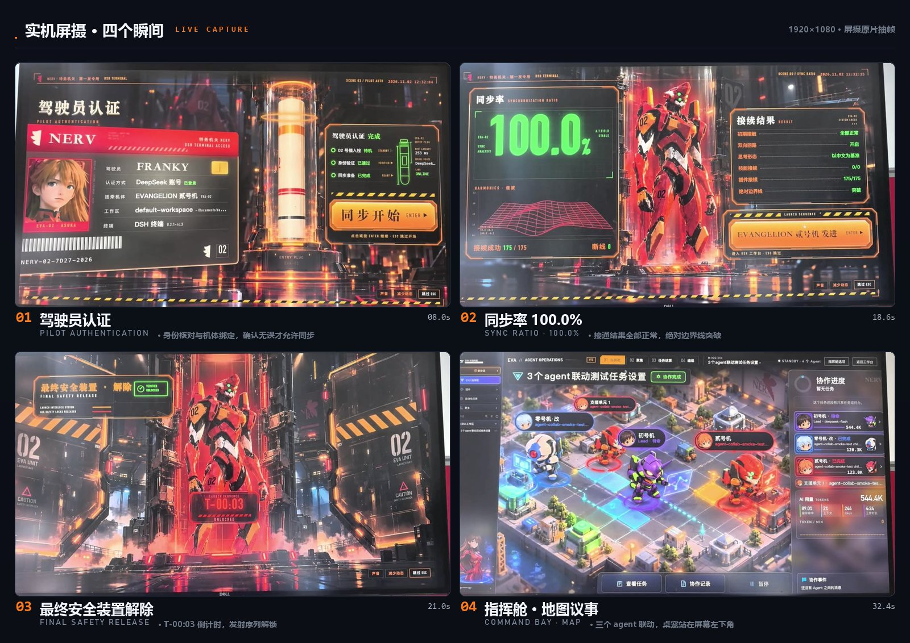
</p>

<p align="center"><sub>同一段录屏里挑出来的四帧，按发生顺序排：<b>驾驶员认证</b> 8.0s → <b>同步率 100.0%</b> 18.6s → <b>最终安全装置解除</b> 21.0s → <b>指挥舱地图议事</b> 32.4s</sub></p>

### 开机序列（逐场 · 素材合成）

<p align="center">
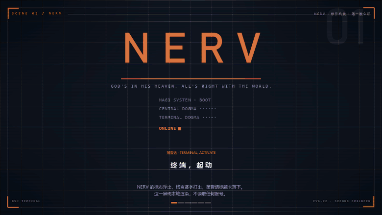
</p>

<p align="center"><sub>NERV → MAGI 审议 → 驾驶员认证 → 神经接续 → 同步率 → 贰号机发进 → 进入工作台（约 5 秒一轮，实际时长取决于本机读取速度）</sub></p>

### 逐场定格

<table>
<tr>
<td width="50%">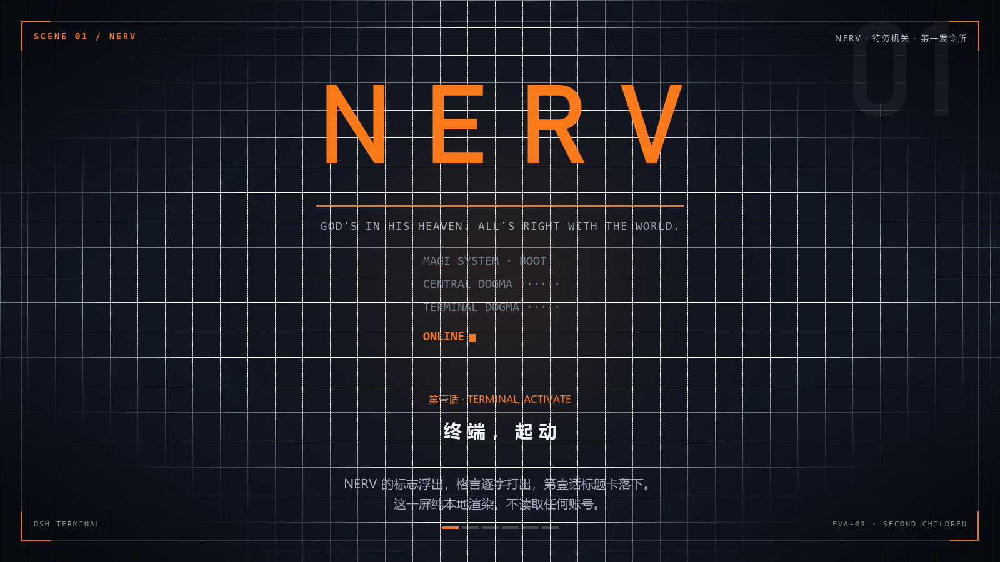<br><sub><b>01 · 终端，起动</b>　NERV 标志 + 格言 + 引导日志，纯本地渲染，不读账号。</sub></td>
<td width="50%">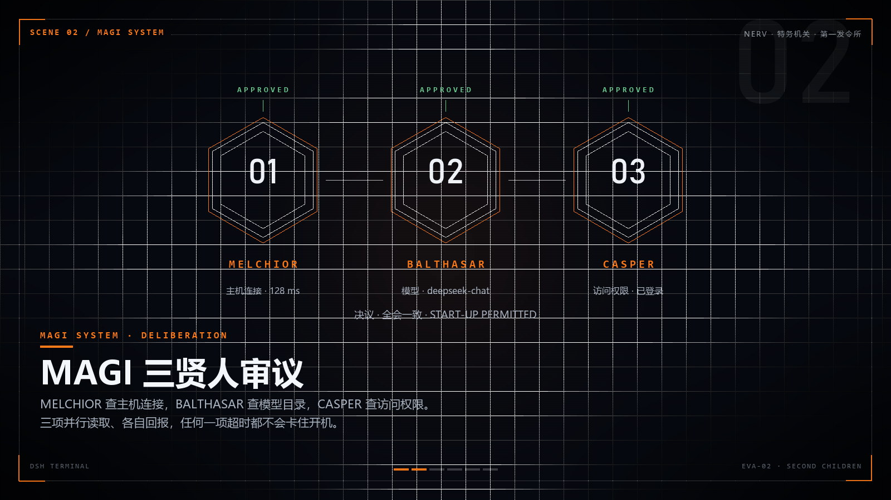<br><sub><b>02 · MAGI 三贤人审议</b>　MELCHIOR 查主机、BALTHASAR 查模型、CASPER 查权限，三项并行。</sub></td>
</tr>
<tr>
<td>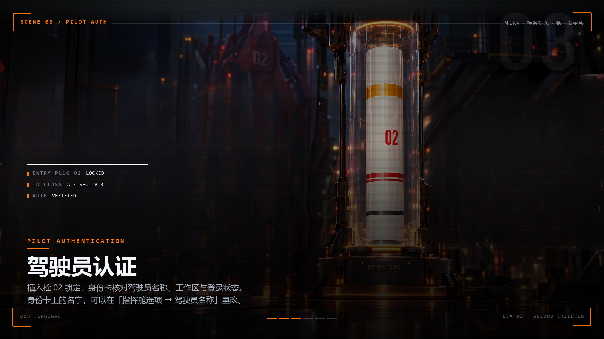<br><sub><b>03 · 驾驶员认证</b>　插入栓 02 锁定，身份卡核对名称 / 工作区 / 登录状态。</sub></td>
<td>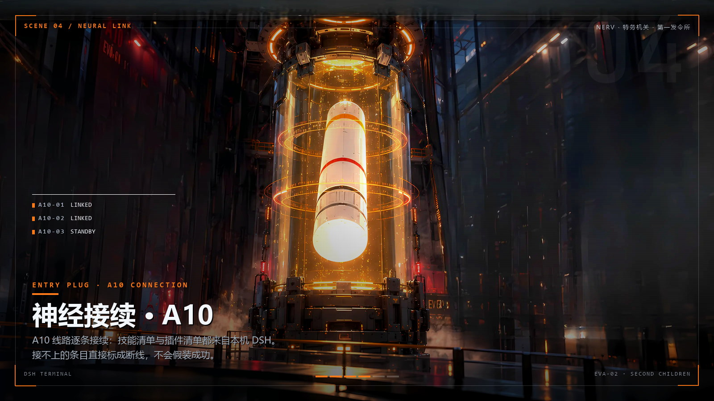<br><sub><b>04 · 神经接续 · A10</b>　技能与插件逐条接续，失败的条目标「断线」。</sub></td>
</tr>
<tr>
<td>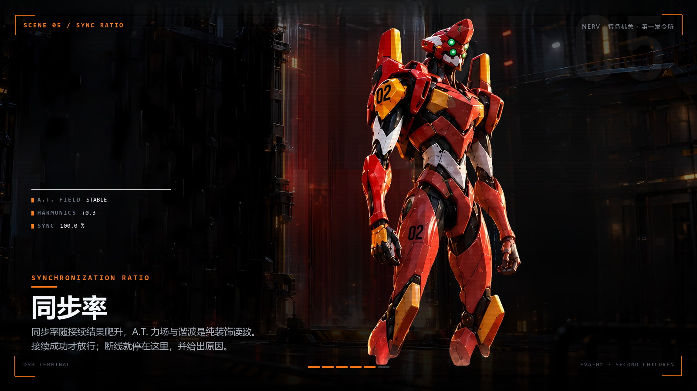<br><sub><b>05 · 同步率</b>　A.T. 力场与谐波是装饰读数，同步率跟着接续结果走。</sub></td>
<td>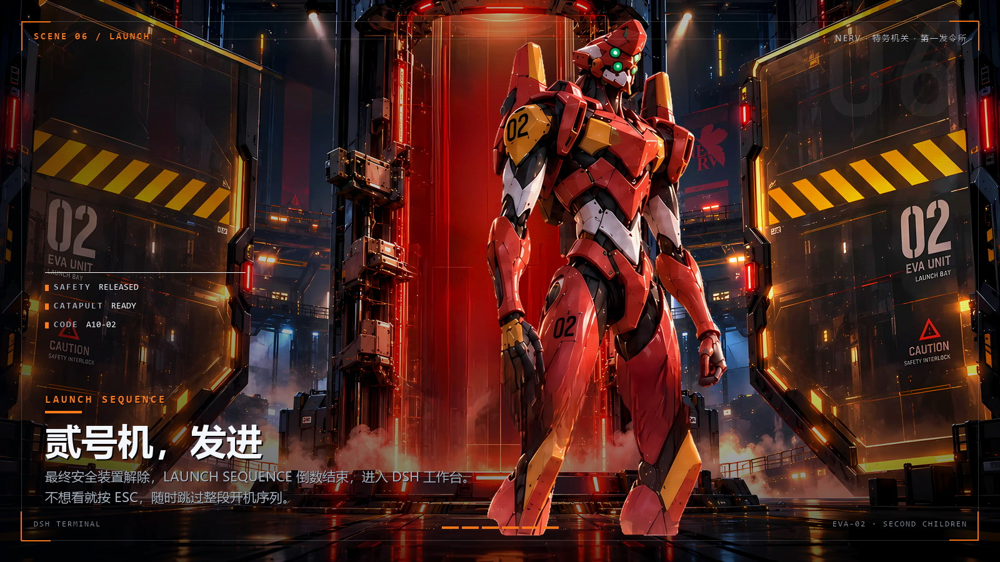<br><sub><b>06 · 贰号机，发进</b>　安全装置解除，倒数结束落进工作台。</sub></td>
</tr>
</table>

### 落进工作台之后（界面定格）

<table>
<tr>
<td width="33%">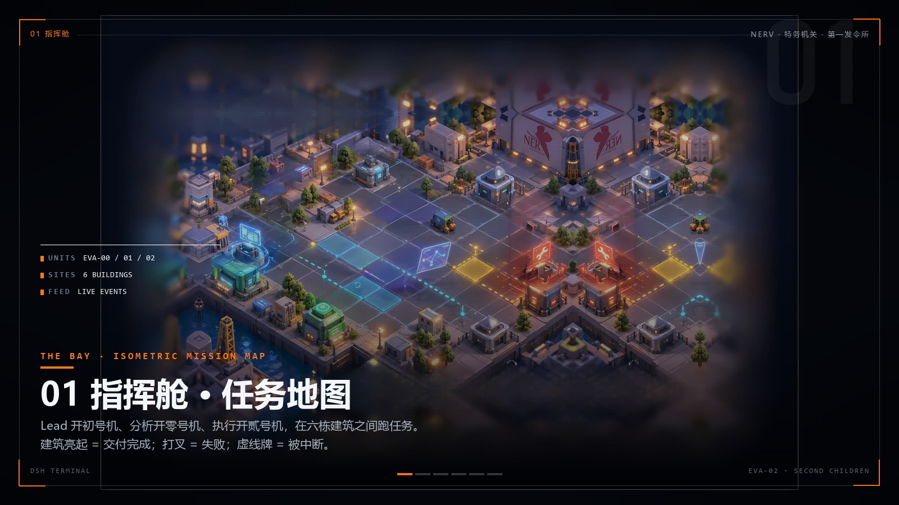<br><sub><b>01 指挥舱</b>　建筑亮起＝交付完成，打叉＝失败，虚线牌＝被中断。</sub></td>
<td width="33%">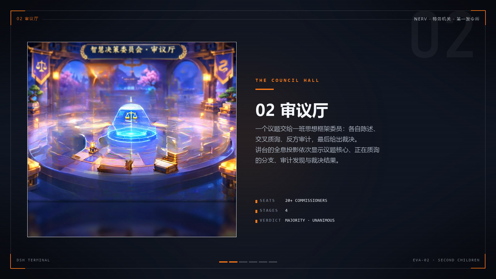<br><sub><b>02 审议厅</b>　一个议题、一班委员、四个阶段、一次裁决。</sub></td>
<td width="33%">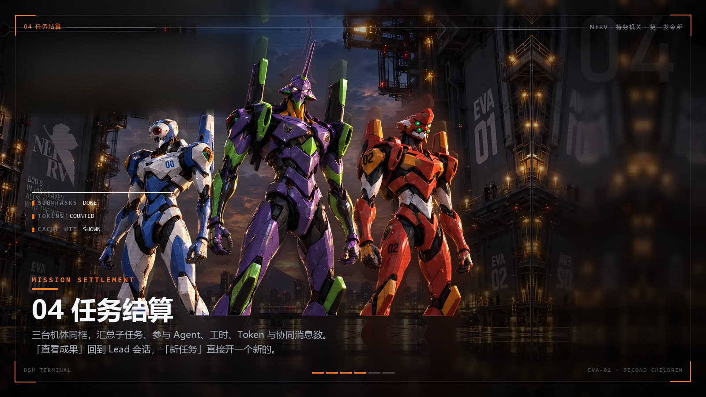<br><sub><b>04 任务结算</b>　三台机体同框，Token 与工时一次结清。</sub></td>
</tr>
</table>

### 桌宠 · 明日香伴侣（实验功能）

除了开机动画、审议厅和任务结算，这一版还有一个能放到桌面上的「她」。

<p align="center">
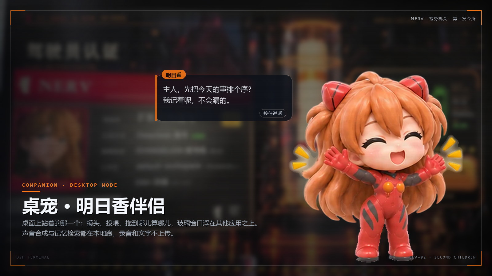
</p>

她站在桌面上，玻璃窗口浮在其他应用之上。摸头、投喂、拖着换位置，都会触发不同的反应；打字或按住说话聊天时，她会开口把回答念出来。声音合成与记忆检索都在本机跑，录音和文字不上传。

<table>
<tr>
<td width="34%" align="center">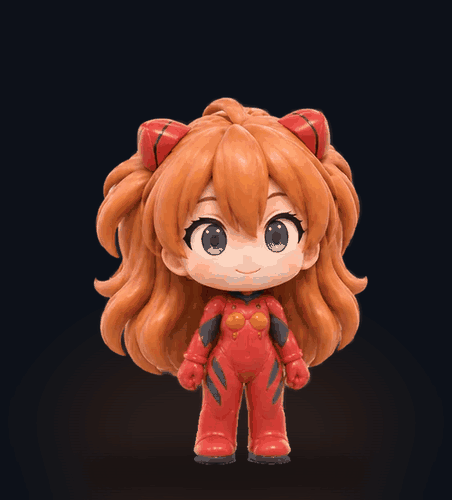<br><sub><b>招手 → 开口说话</b><br>口型不是随机抖动，是跟着朗读的音节在四个嘴型之间切。</sub></td>
<td width="66%" align="center">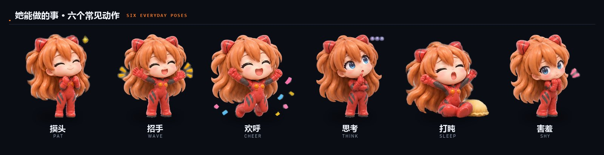<br><sub><b>摸头 / 招手 / 欢呼 / 思考 / 打盹 / 害羞</b><br>动作由事件触发（摸头、投喂、任务完成、长时间不理她），不是循环播放的贴图。</sub></td>
</tr>
</table>

<details>
<summary><sub>这组画面是素材合成，不是屏摄（点开看）</sub></summary>

立绘、过渡帧和嘴型都取自源码包内的桌宠资源：

```
packages/experimental/client-ui-companion/src/client/assets/
├── key-*.webp        # 480×480 关键帧（招手、欢呼、打盹……约 20 个动作，每个 3 帧）
├── tween-*.webp      # 2880×480，一条六帧的过渡序列
├── stroll-*.webp     # 5280×480，十一条的走路循环
└── lip-*.webp        # 480×480 的嘴型层，只有嘴那一小块有像素
```

上面那张桌面场景，背景用的是实机录屏里的一帧、做了虚化，对话框和底部标题是按 app 内的玻璃窗样式复刻的。**真机上的摸头、投喂、拖动要自己装好才能玩到** —— 想先看一眼，实机录屏走到「指挥舱地图」那一帧时，她的确站在屏幕左下角。

</details>

<details>
<summary><sub>开机与工作台这些图是怎么来的（点开看）</sub></summary>

除实机屏摄与桌宠（各有一段单独说明）之外，其余画面都取自源码包内的界面素材：

```
packages/client/ui-command-bay/src/client/assets/
├── boot-auth-plate.webp / boot-link-plate.webp     # 3200×1800 背景板
├── boot-sync-plate.webp / boot-launch-plate.webp
├── boot-sync-unit.webp / boot-launch-unit.webp     # 机体立绘（透明通道）
├── complete-plate.webp + complete-units.webp       # 结算画面，两层按 app 内相同方式叠加
├── bay-map-wide.webp                               # 4368×2974 等距地图
├── council-hall.webp / council-*.webp              # 审议厅与委员立绘
└── boot-sfx-*.ogg / boot-voice-*.ogg               # 开机音效与语音
```

合成时套用了和 app 内一致的 HUD 排版（`SCENE 0X / NAME`、进度段、身份卡字段），并叠了一层细扫描线与暗角。**素材本身是原装的，排版是复刻的。**

实机演示那段是另一回事：它是`demo/DSH-EVA kit-Demo.mp4` 直接抽帧压缩的，只做了裁边（去掉显示器边框）、缩放与抽帧压缩（640px / 8fps），**没有合成、没有补画、没有逐帧修图**。

</details>

---

## 目录与文件说明

```
dsh-eva-windows-kit/
├── dsh-eva-windows-kit-v2-cpu/         # 通用版（无独显也能用）
│   ├── build-windows.cmd               # ← 双击这里开始构建
│   ├── build-windows.mjs               # 构建逻辑本体
│   ├── dsh-eva-share-src.tar.gz        # 源码包 70.8 MB
│   ├── self-check.cmd / self-check.mjs # 声音与记忆的自检
│   ├── verify-share.mjs                # 转发前复查本机痕迹
│   ├── SHA256SUMS.txt                  # 上列 7 个文件的校验值
│   └── README.txt                      # 套件说明（开源口径）
├── dsh-eva-windows-kit-v2-nvidia/      # N 卡版（明日香日语用克隆声）
│   └── …（文件同名同结构，仅源码包与 README 不同）
├── docs/
│   └── DSH-EVA版-Windows安装配置手册-第2版.pdf   # 14 页完整手册
├── demo/
│   └── DSH-EVA kit-Demo.mp4            # 38 秒实机录屏 1080p
├── assets/showcase/                    # 本页展示图与动图
├── LICENSE                             # MIT（打包、脚本、文案）
└── THIRD-PARTY-NOTICES.md              # EVA 素材 / 插件 / 模型 的条款
```

| 文件 | 作用 | 备注 |
|---|---|---|
| `build-windows.cmd` | 双击入口：查 Node 24，转调 `.mjs` | 必须在解压后的真实目录里跑 |
| `build-windows.mjs` | 真正干活的脚本：查 6 个工具、查 25 GB 空间、装 pnpm 11.28.5、构建、自检、出包 | 支持 `--root` `--cn-mirror` `--proxy` `--check-only` `--rehearse` |
| `dsh-eva-share-src.tar.gz` | 源码包，构建时解到 `C:\dsh-build` | 单文件 70.8 MB，含 `packages/client/ui-command-bay` 全部 EVA 素材 |
| `self-check.cmd` / `.mjs` | 只读检查显卡、uv、已下载模型，生成 `DSH-自检结果.txt` | **不读密钥**，可放心转发 |
| `verify-share.mjs` | 扫描构建产物里有没有本机用户名 / 机器名 / 用户态文件 | 转发安装包前跑一次 |
| `SHA256SUMS.txt` | 7 个文件的 SHA-256 | 见下方[校验](#校验) |
| `README.txt` | 原包随附的中文说明 | 与本文档内容一致，纯文本版 |

> 📘 完整手册（14 页，含逐步截图与全部报错对照）：[DSH-EVA版-Windows安装配置手册-第2版.pdf](docs/DSH-EVA%E7%89%88-Windows%E5%AE%89%E8%A3%85%E9%85%8D%E7%BD%AE%E6%89%8B%E5%86%8C-%E7%AC%AC2%E7%89%88.pdf)

### 只取一个版本

仓库里两个源码包各 70.8 MB，直接从网页「Download ZIP」会把两份都拉下来。只想要一个版本时：

```bash
# 只检出通用版（其余文件不下载）
git clone --depth 1 --filter=blob:none --sparse https://github.com/goking81/dsh-eva-windows-kit.git
cd dsh-eva-windows-kit
git sparse-checkout set dsh-eva-windows-kit-v2-cpu

# 换成 N 卡版就把最后一行改成 dsh-eva-windows-kit-v2-nvidia
```

---

## 安装与使用

> 全程不需要任何账号，也不需要懂这个项目。**粗估 30–60 分钟**，主要花在下载上。

### 0 · 先确认机器够不够

| 项目 | 要求 |
|---|---|
| 系统 | Windows 10（1803+）或 Windows 11，**64 位**，不支持 ARM 版 Windows |
| 磁盘 | 构建所在盘 ≥ **25 GB** 空闲（脚本会检查） |
| 网络 | 能访问 npm / GitHub / nodejs.org；声音与记忆还要 pypi.org、download.pytorch.org、huggingface.co |
| 模型 | 一个你自己的 API 密钥（如 DeepSeek） |

### 1 · 装齐 6 个工具

Node.js 24 去 [nodejs.org/dist/latest-v24.x](https://nodejs.org/dist/latest-v24.x/) 下 `-x64.msi`；其余在 PowerShell 里逐行：

```powershell
winget install --id Git.Git
winget install --id Microsoft.PowerShell
winget install --id Python.Python.3.12
winget install --id Microsoft.VisualStudio.2022.BuildTools --override "--add Microsoft.VisualStudio.Workload.VCTools --includeRecommended --passive --wait"
winget install --id astral-sh.uv
```

装完 **关掉所有命令行窗口重开**，最好再注销一次让 `uv` 生效。检查：

```powershell
node --version; git --version; pwsh --version; python --version; uv --version
```

`node` 应以 `v24` 开头。

### 2 · 构建

解压后**双击 `build-windows.cmd`**。中途失败可以重跑，它会接着做。下载慢时：

```powershell
.\build-windows.cmd --cn-mirror
.\build-windows.cmd --proxy http://127.0.0.1:7890
```

成功后安装包在 `C:\dsh-build\output\`，旁边的 `SHA256.txt` 是它的校验值。

### 3 · 安装

双击 `.exe`。因为没做数字签名，Windows 会提示「已保护你的电脑」→ **更多信息 → 仍要运行**。装好后打开，点「添加 API Key」填自己的密钥（以后在「更多 → 设置 → 模型」里改）。

### 4 · 打开新功能

新功能默认关闭。左侧栏「插件 → 实验性插件」里打开「智慧决策委员会」「明日香伴侣」「语音输入」。

第一次让明日香开口前，点她气泡里的**「准备声音」**：

| 版本 | 日语 | 中文 | 首次下载 |
|---|---|---|---|
| 通用版（CPU） | 5 个 CPU 合成女声 | 6 个 CPU 合成女声 | 约 0.5 GB |
| N 卡版 | 本人克隆声，需驱动 570+、显存 ≥ 4 GB（CUDA 12.8） | 6 个 CPU 合成女声 | 约 10 GB（PyTorch ≈ 6 GB + 模型 ≈ 3.7 GB） |

记忆功能第一次使用时另下约 0.9 GB 向量模型。声音与记忆全部**本地合成/本地检索**，不过任何在线服务。

### 5 · 清理

安装包复制走后，`C:\dsh-build` 就可以删了：

```powershell
Remove-Item -Recurse -Force C:\dsh-build
```

---

## 两个版本怎么选

| | 通用版 `-v2-cpu` | N 卡版 `-v2-nvidia` |
|---|---|---|
| 适合谁 | 没独显 / 不确定 / 想省空间 | 有 NVIDIA 卡，想要明日香本人的日语声 |
| 显卡要求 | 无 | 驱动 **570+**，显存 **≥ 4 GB** |
| 日语声音 | CPU 合成，5 选 1 | 本地克隆声，显卡合成 |
| 首次下载 | ≈ 0.5 GB | ≈ 10 GB |
| 出问题怎么办 | 跑 `self-check.cmd` | 跑 `self-check.cmd`，或**直接改装通用版** |

两个版本装在同一个位置，**后装覆盖先装**，设置和对话都保留。

---

## 注意事项

| | 事项 |
|---|---|
| ⚠️ | **未在真实 Windows 上实测**：随包手册写明「两个版本的构建脚本都已在 macOS 上用同样步骤走通，CPU 中日语声音与记忆向量实测正常」，但 Windows 上的完整流程、N 卡版显卡朗读、桌面浮窗都还没实机验证。踩坑请回[常见问题](#常见问题)或把日志发给分享者 |
| ⚠️ | **没有数字签名**：SmartScreen 拦截属正常，需手动「仍要运行」 |
| ⚠️ | **不会自动更新**，也没有使用统计。会话日志上传、反馈上传在本版本已关闭；左下角「意见反馈」会打开网页表单，不点就不发 |
| ⚠️ | **EVA 角色形象有版权**：可自由下载使用与再分发，但角色形象版权归 Khara / GAINAX，请勿单独提取或用于商业产品 |
| ✅ | 声音、记忆全本地；「聊最新新闻」会读几家新闻站 RSS 标题，不打开就不联网 |
| ✅ | 清理干净：构建目录可删，卸载后 `%USERPROFILE%\.dsh`、`%APPDATA%\DeepSeek Harness`、`文档\deepseek-harness\default-workspace` 需手动确认 |

---

## 校验

```powershell
# 校验源码包（应与下方一致）
Get-FileHash .\dsh-eva-share-src.tar.gz -Algorithm SHA256

# 或一次校验整个套件
Get-Content .\SHA256SUMS.txt | ForEach-Object { $h,$f = $_ -split '\s+',2; "$f" }
```

| 版本 | `dsh-eva-share-src.tar.gz` SHA-256 |
|---|---|
| 通用版 CPU | `869f0e92b017f24408fb3f62393514c772c585119a9514c7f56b7da1f3722e22` |
| N 卡版 NVIDIA | `be012032ea8115ff9628535577815dd9a44f70eb9226c563b159653cc1e4175a` |

构建完、转发前，建议再跑一次：

```powershell
node .\verify-share.mjs C:\dsh-build\output
```

---

## 常见问题

| 现象 | 处理 |
|---|---|
| `Node.js 24 was not found` | 装 Node 24，关窗口重开 |
| 缺少以下工具 | 按提示装，关掉所有命令行窗口重试 |
| 找不到 `…tar.gz`。请先完整解压 | 你在压缩包里直接运行了，先解压 |
| 源码包校验不通过 | 传输损坏，重新获取 |
| 只剩 N GB，至少需要 25 GB | 清盘，或 `--root D:\dsh-build` 换盘（目录**不能带用户名或空格**） |
| `ETIMEDOUT` / `ECONNRESET` / 下载卡住 | 先重试；再加 `--cn-mirror`，镜像覆盖不到的部分（GitHub、nodejs.org）走 `--proxy` |
| 提示找不到 Visual C++ 或 Windows SDK | Visual Studio Installer 里勾上「使用 C++ 的桌面开发」 |
| `python --version` 跳到微软商店 | 设置 → 应用 → 高级应用设置 → 应用执行别名，关掉 python 的两个别名 |
| 构建特别慢 | Windows 安全中心把 `C:\dsh-build` 加排除项，实时扫描很拖小文件 |
| 复查未通过 | 产物里带了本机用户名/机器名。自己用没问题，转发前先看看那段输出 |
| 安装时提示「DeepSeek Harness 正在运行」 | 托盘右键图标 → 退出，再装 |
| 模型列表「暂无可用模型」 | 还没保存 API 密钥 |
| 准备声音失败并提到 `uv` | 装 uv，注销/重启后再点「准备声音」 |
| N 卡版 `found no NVIDIA GPU` / 显存不足 | 驱动升到 570+，关掉占显存的程序；不行就换通用版 |

解决不了时要发什么：`C:\dsh-build\logs\` 里最新的日志。**发之前把用户名替换掉，永远不要发 API 密钥。**

---

## 致谢与许可

> ✅ **本仓库以 MIT 开源**：打包、构建脚本、文案与展示图排版，都可以自由使用、修改、再分发，见 **[LICENSE](LICENSE)**。
> ⚠️ 但有三类内容不属于 MIT：**EVA 角色形象**（Khara / GAINAX，非商业同人使用）、**`dsh-fish-memory` 插件**（Yuuyuko-uu 插件许可 1.2）、**声音与向量模型**（各自条款，使用时另行下载）。逐条说明见 **[THIRD-PARTY-NOTICES.md](THIRD-PARTY-NOTICES.md)**。

| 对象 | 说明 |
|---|---|
| DeepSeek Harness | 本体。项目使用 **MIT** 许可，全文见源码内 `LICENSE` |
| [dsh-fish-memory](https://github.com/Yuuyuko-uu/dsh-fish-memory) | 明日香记忆派生自 @Yuuyuko-uu 的插件，遵循 **Yuuyuko-uu 插件许可 1.2**（全文随包附于 `node_modules/dsh-fish-memory/LICENSE`）。改动：记忆仅用于明日香会话、固定单库、接入本地向量检索、长期事实可被取代、每月快照。补丁见源码 `patches/dsh-fish-memory@1.5.8.patch` |
| Irodori-TTS | MIT；**禁止未经同意克隆他人声音** |
| Kokoro | Apache-2.0 |
| Supertonic 3 | OpenRAIL-M，有使用限制 |
| Qwen3-Embedding | Apache-2.0（记忆检索） |
| 《新世纪福音战士》 | 角色与视觉设定版权归 Khara / GAINAX。本套件**非官方、非商用**同人作品，与权利人无关联 |

<div align="center"><sub>

整理与排版：把两个 kit 与手册归档，展示图用仓库内素材复刻排版 —— 不是实机录屏。kit 内 `README.txt` 的开源口径已与本页对齐。
如果它让你某天早上打开电脑时笑了一下，这个仓库就算成了。

</sub></div>
